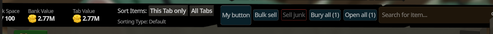

# Cookbook
{: .no_toc }

Copy-paste code for the everyday tasks. Every recipe on this page is compiled and run against the real game by
the loader's test rig, so it works as printed (game 0.11.6-alpha.1).
{: .fs-5 .fw-300 }

{: .tip }
> The recipes assume `game` is the open character's `Game` (from `GameAccess.CurrentGame`, checked with
> `IsSaveLoaded`) and `ctx` is your `ModContext`. The `using` lines each recipe needs are listed at the end of
> the page.

1. TOC
{:toc}

---

## Mod structure

### Notice a character being opened or closed

`OnLoad` runs before any character is open, and the player can switch characters at any time. Most mods start
with this:

```csharp
Game? _game;
int _frame;

void CharacterFrame()   // ctx.Frame += CharacterFrame; in OnLoad
{
    if (++_frame % 30 != 0) return;                       // twice a second is enough
    Game? now = GameAccess.CurrentGame;
    if (now is not { IsSaveLoaded: true }) now = null;
    if (ReferenceEquals(now, _game)) return;               // nothing changed
    _game = now;
    if (now != null) OnCharacterOpened(now);
    else OnCharacterClosed();
}
```

Opening another character creates a new `Game` object, with new entities and components. Subscribe to the
game's events in `OnCharacterOpened`, for that game: the old subscriptions go away with the old game.

### A hotkey

```csharp
bool _wasDown;

void HotkeyFrame()
{
    bool down = Input.IsKeyPressed(Key.F10);
    if (down && !_wasDown) Toggle();   // once per press, not every frame it is held
    _wasDown = down;
}
```

`Input.IsKeyPressed` reads the key itself, also while the player types in a text box. Function keys are the
safe choice. The mods on this wiki use F5 to F9.

### Every second

```csharp
ulong _last;

void TimerFrame()
{
    ulong now = Time.GetTicksMsec();
    if (now - _last < 1000) return;
    _last = now;
    // ... once a second
}
```

### A Godot timer or signal of your own

`ctx.Frame` is never raised while the game computes offline progress. Your own Godot timers and signals are, so
check for it yourself:

```csharp
_ctx.Tree.CreateTimer(5.0).Timeout += () =>
{
    if (GameAccess.IsComputingOffline) return;   // the game runs on another thread right now: hands off
    // ... safe to touch the game here
};
```

## Items and the bank

### The bank

```csharp
public static BankEntity? Bank(Game game) =>
    game.Entities.TryGetObjectById("MelvorBase:Bank", out GameEntity? e) ? e as BankEntity : null;
```

### Find an item

By id (stable, the same in every language):

```csharp
public static Item? ItemById(Game game, string id) =>
    game.Data.GetDataRegistryOutput<Item>().TryGetObjectById(id, out Item? item) ? item : null;
```

By its English name, for when a player types it:

```csharp
public static Item? ItemByName(Game game, string name) =>
    game.Data.GetDataRegistryOutput<Item>().GetAllObjects()
        .FirstOrDefault(i => string.Equals(i.DisplayName.GetPluralText(1), name, StringComparison.OrdinalIgnoreCase));
```

`ItemById(game, "MelvorBase:OakLog")` and `ItemByName(game, "oak log")` return the same item.

### Count, add and remove items

```csharp
int have = bank.Inventory.GetQuantity(item);
int added = bank.Inventory.AddQuantity(item, 100);      // returns how many actually went in
int removed = bank.Inventory.RemoveQuantity(item, 40);  // returns how many actually came out
```

A full bank takes fewer than you asked for; the return value tells you how many.

### Gold and other currencies

```csharp
long added = bank.Wallet.AddGoldPieces(1_000);
Currency gold = game.Data.GetDataRegistryOutput<Currency>().GetObjectById("MelvorBase:GoldPieces");
long gp = bank.Wallet.GetQuantity(gold);
```

The game has three currencies: `MelvorBase:GoldPieces`, `MelvorBase:SlayerCoins`, `MelvorBase:PrayerPoints`.
For the others use `bank.Wallet.AddQuantity(currency, amount)`.

### Sell like the game does

```csharp
public static void Sell(BankEntity bank, Item item, int quantity)
{
    var stats = bank.ItemSales.GetItemStats(item);       // the price, with every bonus applied
    try { bank.ItemSales.SellItem(item, stats, quantity); }
    finally { stats.Destroy(); }                          // stat objects must be released
}
```

Selling through the game updates the gold, the statistics and the `ItemSold` event, and applies sale bonuses.
Respect the player's locks: skip stacks where `stack.IsLocked` is true.

## Skills

### Levels and XP

```csharp
string all = string.Join(", ", game.LeveledEntities.Select(s => $"{s.DisplayName.Text} {s.Experience.Level}"));
```

### Set a level

```csharp
public static void SetLevel(Game game, string skillId, int level)
{
    var skill = game.LeveledEntities.First(s => s.Id == skillId);
    var xp = skill.Experience;
    xp.SetXp(xp.Table.GetXpForLevel(Math.Clamp(level, 1, xp.LevelCap)));
}
```

`SetLevel(game, "MelvorBase:Thieving", 30)`. The game shows its own "Level Up!" message as if it had been
earned.

## Events

The game raises events for almost everything. A few useful ones:

```csharp
BankEntity bank = Bank(game)!;
bank.ItemSales.ItemSold += (_, e) =>
    ctx.Log($"Sold {e.Quantity} x {e.Item.DisplayName.GetPluralText(e.Quantity)} for {e.CurrencyGain.Quantity}");

if (game.Entities.TryGetObjectById("MelvorBase:Combat", out GameEntity? c) && c is CombatEntity combat)
    combat.Loot.EnemyLooted += (_, e) =>
        ctx.Log($"{e.Enemy.DisplayName.Text} dropped {string.Join(", ", e.Items.Select(i => $"{i.Quantity} {i.Item.DisplayName.GetPluralText(i.Quantity)}"))}");

foreach (var skill in game.LeveledEntities)
    skill.Experience.LevelChanged += (_, e) => ctx.Log($"{skill.DisplayName.Text} is now level {e.NewValue}");
```

{: .warning }
> Game events are also raised while the game computes offline progress, **on the game's background thread**.
> Changing game data in a handler is fine (it is the game's own thread). Touching your user interface is not:
> remember what happened and update the screen in your next `Frame`.

More events worth knowing: `bank.Inventory.ItemQuantityChanged`, `combat.Enemy.Killed`,
`combat.Action.PlayerDied`, `game.ActionManager.ActionStarted` / `ActionStopped`, `slayer.Tasks.TaskCompleted`.

## Actions

### What is the character doing?

```csharp
public static string WhatIsRunning(Game game)
{
    ActionComponent? running = game.ActionManager.ActiveActions.LastOrDefault();
    return running == null ? "nothing"
        : $"{running.Entity.DisplayName.Text}: {running.CurrentDescription?.DisplayName.Text ?? "?"}";
}
```

Prints, for example, `Woodcutting: Duskleaf Bush`.

### Start an action

```csharp
public static bool StartWoodcutting(Game game)
{
    if (!game.Entities.TryGetObjectById("MelvorBase:Woodcutting", out GameEntity? e) || e is not WoodcuttingEntity wc) return false;
    WoodcuttingTree? tree = wc.Action.Trees.Values.LastOrDefault(t => t.Recipe.Requirements.AreMet);   // the best tree we may cut
    if (tree == null) return false;
    if (!wc.Action.IsStarted || wc.Action.CuttingTree != tree) wc.Action.SelectTree(tree);              // selecting the running tree again would stop it
    return wc.Action.IsStarted;
}
```

Two things to copy from this for every skill: **check the requirements yourself** (the select calls do not), and
**do not select what already runs** (it toggles off). The calls for each skill are listed in
[Inside the game](inside-the-game#actions-what-the-character-is-doing).

### Stop

```csharp
game.ActionManager.TryStopActive();
```

## Add a bonus (modifier)

Give the character 100 extra bank slots, through the same system the game uses for its own bonuses:

```csharp
[UnsafeAccessor(UnsafeAccessorKind.Method, Name = "get_Modifiers")]
static extern ModifierSystem GetModifiers(Game game);

sealed class Source(string name) : INamedObject
{
    public ILocalizedString DisplayName { get; } = new LocalizedString(name);
}

static readonly Source BankBonus = new("My mod: extra bank slots");
static ModifierValues? s_bankValues;
static Game? s_bankValuesFor;

// A modifier says: "this stat, on this component, changes by this much". The game reads the same JSON
// shape from its data files, so the value is built from JSON. Build it once per character and keep the
// object: the game recognises a modifier by the object itself, not by what is in it.
static ModifierValues BankValues(Game game)
{
    if (s_bankValues != null && ReferenceEquals(s_bankValuesFor, game)) return s_bankValues;
    string json = """
        {
          "Stat": { "StatsType": "MelvorBase:BankInventory", "Name": "FlatMaxStacks" },
          "Value": 1,
          "LocalContext": { "Component": { "Entity": "MelvorBase:Bank", "Component": "Inventory" } },
          "FromContext": null, "Condition": null, "Scaling": null
        }
        """;
    var value = new ComponentModifierValue(game.Data, JsonDocument.Parse(json).RootElement);
    s_bankValues = new ModifierValues(new List<GlobalModifierValue>(), new List<ComponentModifierValue> { value }, new List<CombatEffectModifierValue>());
    s_bankValuesFor = game;
    return s_bankValues;
}

public static void AddBankSlots(Game game, int slots) =>
    GetModifiers(game).AddOrUpdate(BankBonus, BankValues(game), slots);   // "Value": 1 slot, times this multiplier

public static void RemoveBankSlots(Game game) => GetModifiers(game).Remove(BankBonus);
```

`AddBankSlots(game, 100)` gives 100 slots, `AddBankSlots(game, 250)` changes it to 250 (not 350),
`RemoveBankSlots(game)` takes them away. The bonus is not saved: add it again whenever the character is opened.

To change something else, change `StatsType`, `Name`, `Entity` and `Component`. A few that work:

| Effect | `StatsType` / `Name` | `Entity` / `Component` | `"Value": 1` means |
|:--|:--|:--|:--|
| bank slots | `BankInventory` / `FlatMaxStacks` | `Bank` / `Inventory` | 1 slot |
| woodcutting speed | `WoodcuttingAction` / `PercentInterval` | `Woodcutting` / `Action` | +100% time (use negative values to go faster: -0.5 = half the time) |
| double logs | `WoodcuttingAction` / `DoublingChance` | `Woodcutting` / `Action` | 100% chance |
| sale prices | `ItemSale` / `PercentPricePerItem` | `Bank` / `ItemSales` | +100% price |
| offline time | `OfflineProgress` / `FlatOfflineTime` | `OfflineProgress` / `Component` | 1 millisecond (3600000 = one hour) |

**Units:** `Percent...` and `...Chance` stats count in fractions (1 = 100%), `Flat...` stats in the stat's own
unit (slots, items, milliseconds). The multiplier you pass to `AddOrUpdate` multiplies `"Value"`.

The [Cheat Menu's settings table](https://github.com/falorfrozen-cmd/MelvorModLoader/blob/main/Mods/CheatMenu/Features.cs)
lists over 60 more that are known to work, with their units.

## Settings and files

### Per-character settings

```csharp
public sealed class MySettings
{
    public bool Enabled { get; set; } = true;
    public int Threshold { get; set; } = 100;
}

public static MySettings LoadSettings(ModContext ctx, Game game)
{
    string file = Path.Combine(ctx.Directory, "settings.json");
    try
    {
        var all = JsonSerializer.Deserialize<Dictionary<string, MySettings>>(File.ReadAllText(file));
        if (all != null && all.TryGetValue(game.CharacterName, out MySettings? mine)) return mine;
    }
    catch { }   // no file yet, or a broken one: start with the defaults
    return new MySettings();
}

public static void SaveSettings(ModContext ctx, Game game, MySettings settings)
{
    string file = Path.Combine(ctx.Directory, "settings.json");
    Dictionary<string, MySettings> all;
    try { all = JsonSerializer.Deserialize<Dictionary<string, MySettings>>(File.ReadAllText(file)) ?? new(); }
    catch { all = new(); }
    all[game.CharacterName] = settings;   // replace only this character's entry
    File.WriteAllText(file, JsonSerializer.Serialize(all, new JsonSerializerOptions { WriteIndented = true }));
}
```

The file ends up as `mods\YourMod\settings.json`:

```json
{
  "ModTest": {
    "Enabled": true,
    "Threshold": 123
  }
}
```

Reading the file again before writing, and replacing only one character's entry, matters: two copies of the
game can run at once, and neither should wipe the other's settings.

## User interface

### A button in one of the game's screens



```csharp
BankInventoryComponentView? _bankView;
Button? _button;

public void OnLoad(ModContext ctx)
{
    _ctx = ctx;
    // The bank page is created the first time the player opens it: catch it when it enters the scene.
    ctx.Tree.NodeAdded += node => { if (node is BankInventoryComponentView view) _bankView = view; };
    ctx.Frame += BankFrame;
}

void BankFrame()
{
    if (_bankView == null) return;
    if (!GodotObject.IsInstanceValid(_bankView)) { _bankView = null; return; }   // the page was freed
    if (!_bankView.IsNodeReady()) return;                                         // not built yet
    if (_button != null && GodotObject.IsInstanceValid(_button)) return;          // already there

    SearchBar? search = GameAccess.FindNode<SearchBar>(_bankView);
    if (search?.GetParent() is not BoxContainer row)
    {
        _ctx.Log("The bank's search box is not where it used to be (the game was updated?).");
        _bankView = null;
        return;
    }
    _button = new Button { Text = "My button", TooltipText = "Added by my mod" };
    _button.Pressed += () => _ctx.Log("Pressed!");
    row.AddChild(_button);
    row.MoveChild(_button, search.GetIndex());   // just before the search box
}
```

The button takes the game's own look automatically, because it sits inside the game's screen. More on windows
and styling: [Building windows](user-interface).

## Advanced

### Reach a private member

Prefer public members. When the one you need is private, .NET's `[UnsafeAccessor]` reaches it directly and with
type checking, without reflection:

```csharp
// A private property: name the getter, "get_" + property name.
[UnsafeAccessor(UnsafeAccessorKind.Method, Name = "get_Modifiers")]
static extern ModifierSystem ModifiersOf(Game game);

// A private field: returns a reference, so you can even replace it.
[UnsafeAccessor(UnsafeAccessorKind.Field, Name = "_activeActions")]
static extern ref List<ActionComponent> RunningListOf(ActiveActionManager manager);
```

{: .warning }
> Private members are the first thing to change when the game updates. When the name is gone, the call throws
> `MissingMethodException` / `MissingFieldException` the first time it runs: catch it and log a clear message.

### Two mods working together

Without a hard dependency, through values on the scene root that both can see:

```csharp
void Publish(int value) => _ctx.Tree.Root.SetMeta("MyMod_Value", value);

int ReadFromOtherMod()
{
    Node root = _ctx.Tree.Root;
    return root.HasMeta("OtherMod_Value") ? root.GetMeta("OtherMod_Value").AsInt32() : 0;
}

bool OtherModInstalled() => Loader.LoadedMods.Contains("ActionQueue");
```

This is how Action Queue and Multitask cooperate: Multitask publishes how many actions may run at once, the
queue publishes which skills it is using, and each works fine without the other.

## The `using` lines

```csharp
using System;
using System.Collections.Generic;
using System.IO;
using System.Linq;
using System.Runtime.CompilerServices;          // UnsafeAccessor
using System.Text.Json;
using GamesByMalcs.Melvor2;                     // Game
using GamesByMalcs.Melvor2.Components.Actions;  // ActionComponent, ActiveActionManager
using GamesByMalcs.Melvor2.Components.CombatEffects; // CombatEffectModifierValue
using GamesByMalcs.Melvor2.Data;                // INamedObject, IReadOnlyDataRegistry
using GamesByMalcs.Melvor2.Data.Currencies;     // Currency
using GamesByMalcs.Melvor2.Data.Items;          // Item
using GamesByMalcs.Melvor2.Entities;            // GameEntity
using GamesByMalcs.Melvor2.Entities.Bank;       // BankEntity, BankInventoryComponentView
using GamesByMalcs.Melvor2.Entities.Combat;     // CombatEntity
using GamesByMalcs.Melvor2.Entities.Woodcutting;// WoodcuttingEntity, WoodcuttingTree
using GamesByMalcs.Melvor2.Localization;        // LocalizedString, ILocalizedString
using GamesByMalcs.Melvor2.Modifiers;           // ModifierSystem, ModifierValues, ...
using GamesByMalcs.Melvor2.SearchBars;          // SearchBar
using Godot;
using MelvorModLoader;
```
