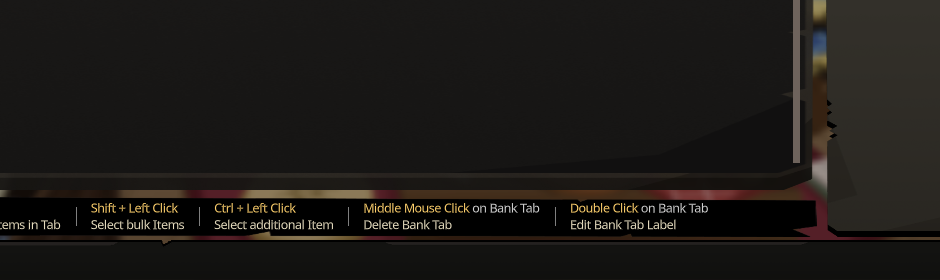

# Your first mod
{: .no_toc }

From an empty folder to your own text on the game screen. About ten minutes.
{: .fs-5 .fw-300 }

By the end you will have a mod that shows the open character's name, total level and gold at the bottom of
the screen, and hides it when you press **F10**:



1. TOC
{:toc}

---

## 1. Check your tools

You need the game with [Melvor Mod Loader installed](../players/install) (the green line appears when the game
starts) and the **.NET 10 SDK**. Open a terminal (PowerShell or Command Prompt) and type:

```
dotnet --version
```

It must print a version that starts with **10**. If it does not, or the command is unknown, install the
**.NET 10 SDK** (not just the runtime) from [dotnet.microsoft.com](https://dotnet.microsoft.com/download) and
open a new terminal.

## 2. Make a folder and a project file

Make a folder for your mod anywhere outside the game, for example `Documents\MelvorMods\HelloMelvor`. In it,
create a file named **`HelloMelvor.csproj`** with exactly this content:

```xml
<Project Sdk="Microsoft.NET.Sdk">
  <PropertyGroup>
    <TargetFramework>net10.0</TargetFramework>
    <AssemblyName>HelloMelvor</AssemblyName>
    <Version>1.0.0</Version>
    <Nullable>enable</Nullable>
    <DebugType>none</DebugType>
    <GenerateDependencyFile>false</GenerateDependencyFile>

    <!-- Where the game is installed. Change this if your Steam library is somewhere else. -->
    <GameDir Condition="'$(GameDir)' == ''">C:\Program Files (x86)\Steam\steamapps\common\Melvor Idle 2</GameDir>

    <!-- Build straight into the game: mods\HelloMelvor\HelloMelvor.dll -->
    <OutputPath>$(GameDir)\mods\$(AssemblyName)\</OutputPath>
    <AppendTargetFrameworkToOutputPath>false</AppendTargetFrameworkToOutputPath>
  </PropertyGroup>

  <ItemGroup>
    <!-- Compile against the loader, Godot and the game. Private=false: the game already has them. -->
    <Reference Include="MelvorModLoader">
      <HintPath>$(GameDir)\data_MelvorModLoader_windows_x86_64\MelvorModLoader.dll</HintPath>
      <Private>false</Private>
    </Reference>
    <Reference Include="GodotSharp">
      <HintPath>$(GameDir)\data_GamesByMalcs.Melvor2_windows_x86_64\GodotSharp.dll</HintPath>
      <Private>false</Private>
    </Reference>
    <Reference Include="GamesByMalcs.Melvor2">
      <HintPath>$(GameDir)\data_GamesByMalcs.Melvor2_windows_x86_64\GamesByMalcs.Melvor2.dll</HintPath>
      <Private>false</Private>
    </Reference>
  </ItemGroup>
</Project>
```

What it does, in plain words:

- **`net10.0`**: the game runs on .NET 10, so your mod targets it too.
- **`GameDir`**: where the game is. If your Steam library is elsewhere (say `D:\SteamLibrary`), change this
  line to that path.
- **`OutputPath`**: the build lands straight in the game's `mods` folder, so there is nothing to copy.
- **The three references** let your code use the loader (`MelvorModLoader.dll`), the Godot engine
  (`GodotSharp.dll`) and the game itself (`GamesByMalcs.Melvor2.dll`). `Private=false` means "compile against
  it, but do not copy it": the game already has these files, and a mod must never ship them.

## 3. Say hello

In the same folder, create **`HelloMelvor.cs`**:

```csharp
using MelvorModLoader;

namespace HelloMelvor;

public class HelloMelvor : IMod
{
    public void OnLoad(ModContext ctx)
    {
        ctx.Log("Hello, Melvor!");
    }
}
```

The loader looks at every DLL in the `mods` folder, finds each public class that implements **`IMod`**, makes
one of it and calls **`OnLoad`** once, when the game starts. `ctx` is your mod's handle to the loader;
`ctx.Log` writes a line to the loader's log file.

## 4. Build it

Open a terminal **in your mod's folder** (in Windows 11: right-click the folder's empty space in Explorer,
then **Open in Terminal**) and build:

```
dotnet build -c Release
```

The last lines should say the build succeeded with 0 errors. Your mod is now in the game folder as
`mods\HelloMelvor\HelloMelvor.dll`.

## 5. See it run

Start the game from Steam. The green line in the top-left corner now counts one more mod. Open
**`MelvorModLoader.log`** in the game folder; near the top you will find:

```
[00:15:20] [HelloMelvor] Hello, Melvor!
[00:15:20] Mod loaded: HelloMelvor 1.0.0 (HelloMelvor.dll)
```

That is your code, running inside Melvor Idle 2. Close the game before the next step.

{: .warning }
> **Always close the game before you build.** While the game runs it keeps your DLL open, and the build fails
> with an error like *"The process cannot access the file ... because it is being used by another process"*.

## 6. Put something on the screen

Replace the content of `HelloMelvor.cs` with this:

```csharp
using System.Linq;
using GamesByMalcs.Melvor2;
using GamesByMalcs.Melvor2.Data.Currencies;
using GamesByMalcs.Melvor2.Entities;
using GamesByMalcs.Melvor2.Entities.Bank;
using Godot;
using MelvorModLoader;

namespace HelloMelvor;

public class HelloMelvor : IMod
{
    ModContext _ctx = null!;
    Label _label = null!;
    bool _shown = true, _wasDown;
    int _frame;

    public void OnLoad(ModContext ctx)
    {
        _ctx = ctx;
        ctx.Log("Hello, Melvor!");

        // A label at the bottom of the screen, on a layer above the game's own screens.
        _label = new Label { Visible = false };
        _label.AddThemeFontSizeOverride("font_size", 18);
        _label.AddThemeColorOverride("font_color", new Color(1f, 0.85f, 0.4f));
        var background = new StyleBoxFlat { BgColor = new Color(0f, 0f, 0f, 0.75f) };
        background.SetContentMarginAll(8);
        background.SetCornerRadiusAll(6);
        _label.AddThemeStyleboxOverride("normal", background);
        _label.SetAnchorsAndOffsetsPreset(Control.LayoutPreset.CenterBottom);
        _label.GrowHorizontal = Control.GrowDirection.Both;
        _label.GrowVertical = Control.GrowDirection.Begin;
        _label.OffsetBottom = -70;

        var layer = new CanvasLayer { Layer = 100 };
        layer.AddChild(_label);
        ctx.Tree.Root.AddChild(layer);

        ctx.Frame += OnFrame;
    }

    void OnFrame()
    {
        // F10 shows or hides the label. React to the moment the key goes down, not to every frame it is held.
        bool down = Input.IsKeyPressed(Key.F10);
        if (down && !_wasDown) _shown = !_shown;
        _wasDown = down;

        // Twice a second is plenty for numbers that change slowly.
        if (++_frame % 30 != 0) return;

        // There is only a game while a character is open. On the main menu this is null.
        Game? game = GameAccess.CurrentGame;
        if (game is not { IsSaveLoaded: true })
        {
            _label.Visible = false;
            return;
        }

        int totalLevel = game.LeveledEntities.Sum(skill => skill.Experience.Level);
        long gold = 0;
        if (game.Entities.TryGetObjectById("MelvorBase:Bank", out GameEntity? entity) && entity is BankEntity bank)
        {
            Currency gp = game.Data.GetDataRegistryOutput<Currency>().GetObjectById("MelvorBase:GoldPieces");
            gold = bank.Wallet.GetQuantity(gp);
        }

        _label.Text = $"{game.CharacterName}   |   Total level {totalLevel}   |   {gold:N0} GP";
        _label.Visible = _shown;
    }
}
```

Build again (`dotnet build -c Release`), start the game and open a character. Your line appears at the bottom
of the screen and follows your progress. **F10** hides and shows it.

## What each part does

**The user interface is plain Godot.** The game is built with the Godot engine, and so is everything you show.
`Label`, `CanvasLayer`, `StyleBoxFlat` are Godot classes. A `CanvasLayer` with a high `Layer` number is drawn
above the game's own screens; anything you add to `ctx.Tree.Root` stays for as long as the game runs.

**`ctx.Frame`** is raised once per rendered frame (about 60 times a second). It is where a mod checks keys and
keeps itself up to date. Keep the work in it small: here the numbers are only refreshed every 30th frame.

**Keys** are read with Godot's `Input.IsKeyPressed`. Remembering the previous state (`_wasDown`) turns "the key
is held" into "the key was just pressed", so one press toggles once.

**`GameAccess.CurrentGame`** is the open character's game, or `null` on the main menu. Check it every time
instead of keeping it: the player can go back to the menu and open another character.

**Entities** are the big parts of the game: the bank, each skill, combat. They are looked up by id, here
`"MelvorBase:Bank"`. `game.LeveledEntities` lists every skill with a level. **Data** (items, monsters,
currencies) comes from `game.Data`; gold is the currency `"MelvorBase:GoldPieces"`.

## Where to go next

- Change the text, the colour, the key. Build, start, look. That loop is most of modding.
- [How loading works](how-it-works) and [the API](api) explain everything the loader does for you.
- [Inside the game](inside-the-game) is the map of the game's classes; the [Cookbook](cookbook) has tested
  code for items, skills, events, bonuses and settings.
- [Building windows](user-interface) when a label is not enough.

{: .tip }
> Want a bigger starting point? The [ExampleMod](https://github.com/falorfrozen-cmd/MelvorModLoader/tree/main/ModdersKit/ExampleMod)
> opens a small window with every skill level on F10, with a comment on every line. It is also in the
> **Modder's Kit** download on the [loader's Nexus page](https://www.nexusmods.com/melvoridle2/mods/2).
