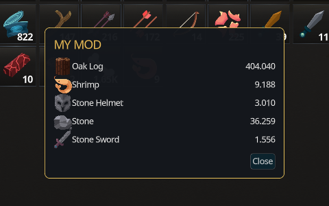

# Building windows
{: .no_toc }

Your own windows, made from Godot controls in code, and buttons inside the game's own screens.
{: .fs-5 .fw-300 }

1. TOC
{:toc}

---

## The idea

The game's whole interface is made of **Godot nodes**, and so is yours. You create controls in C# (`Label`,
`Button`, `PanelContainer`...), put them in a `CanvasLayer`, and add that to `ctx.Tree.Root`. There are no
scene files to load and no editor to open: everything is code.

If you have never used Godot: a **node** is an object in a tree; a **Control** is a node that is drawn on screen;
**containers** (`VBoxContainer`, `HBoxContainer`, `GridContainer`, `CenterContainer`, `PanelContainer`) arrange
their children for you. Godot's [class reference](https://docs.godotengine.org/en/stable/classes/index.html)
covers every control; the C# names are the same, in PascalCase.

## A complete window



```csharp
CanvasLayer? _layer;
VBoxContainer _rows = null!;

void BuildWindow()
{
    _layer = new CanvasLayer { Layer = 110, Visible = false };       // above the game's screens

    // A full-screen container that centres the window but lets clicks through everywhere else.
    var center = new CenterContainer { MouseFilter = Control.MouseFilterEnum.Ignore };
    center.SetAnchorsPreset(Control.LayoutPreset.FullRect);
    _layer.AddChild(center);

    // The window itself: a panel with its own background (the game's panel styles are see-through).
    var panel = new PanelContainer { CustomMinimumSize = new Vector2(420, 0) };
    var frame = new StyleBoxFlat { BgColor = new Color(0.08f, 0.09f, 0.11f, 0.97f), BorderColor = new Color(0.9f, 0.75f, 0.35f) };
    frame.SetBorderWidthAll(1);
    frame.SetCornerRadiusAll(8);
    frame.SetContentMarginAll(16);
    panel.AddThemeStyleboxOverride("panel", frame);
    center.AddChild(panel);

    var column = new VBoxContainer();
    column.AddThemeConstantOverride("separation", 8);
    panel.AddChild(column);

    var title = new Label { Text = "MY MOD" };
    title.AddThemeFontSizeOverride("font_size", 20);
    title.AddThemeColorOverride("font_color", new Color(0.93f, 0.75f, 0.35f));
    column.AddChild(title);

    _rows = new VBoxContainer();
    column.AddChild(_rows);

    var close = new Button { Text = "Close", SizeFlagsHorizontal = Control.SizeFlags.ShrinkEnd };
    close.Pressed += () => _layer.Visible = false;
    column.AddChild(close);

    _ctx.Tree.Root.AddChild(_layer);
}

// One row per item: its picture, its name and how many the bank holds.
void ShowItems(Game game, BankEntity bank, IEnumerable<Item> items)
{
    foreach (Node old in _rows.GetChildren()) old.QueueFree();
    foreach (Item item in items)
    {
        var row = new HBoxContainer();
        row.AddChild(new TextureRect
        {
            Texture = item.Icon, CustomMinimumSize = new Vector2(32, 32),
            ExpandMode = TextureRect.ExpandModeEnum.IgnoreSize, StretchMode = TextureRect.StretchModeEnum.KeepAspectCentered,
        });
        row.AddChild(new Label { Text = item.DisplayName.GetPluralText(1), SizeFlagsHorizontal = Control.SizeFlags.ExpandFill });
        row.AddChild(new Label { Text = bank.Inventory.GetQuantity(item).ToString("N0") });
        _rows.AddChild(row);
    }
}
```

Build the window once (in `OnLoad`, or the first time it is opened), then only show, hide and refill it. Open
it with a [hotkey](cookbook#a-hotkey) and check that a character is open first.

## Layers

`CanvasLayer.Layer` decides what is drawn on top: a higher number is drawn above a lower one. The mods on this
wiki use 100 to 120 and are drawn above everything the game shows; the loader's green line is 128. Use
something in the 100s for windows, and keep small overlays a bit below your windows.

## Clicks: who gets them

Every `Control` takes mouse clicks inside its rectangle unless told otherwise. A full-screen container that
should not block the game needs `MouseFilter = Control.MouseFilterEnum.Ignore`. Do the same for decorative
labels over the game. A dark full-screen shade behind a window *should* block clicks if your window is modal.

## The game's theme, and its quirks

Controls take their look from a `Theme`. Inside the game's screens they get the game's own theme. On your own
`CanvasLayer` they get Godot's defaults, which look plain but work. The game's theme has three quirks that bite
mods placed inside its screens:

| Quirk | What to do |
|:--|:--|
| Pop-up panels (`PopupPanel`) are see-through | Give the panel a `StyleBoxFlat` with `AddThemeStyleboxOverride("panel", ...)`. |
| Check boxes (`CheckButton`, `CheckBox`) use very large art | Use a `Button` with `ToggleMode = true` and "ON/OFF" text instead. |
| Sliders (`HSlider`) have no visible track | Give them `grabber_area` and `slider` style boxes of your own. |

For a window with many controls, build one `Theme` in code and set it on the window's root
(`panel.Theme = myTheme`): every control inside inherits it. The [Cheat Menu's
`Style.cs`](https://github.com/falorfrozen-cmd/MelvorModLoader/blob/main/Mods/CheatMenu/Style.cs) is a complete
example (buttons, option lists, text boxes, sliders, tables), used by three of the mods.

## Useful controls

| Control | For |
|:--|:--|
| `Label` | Text. `AutowrapMode = TextServer.AutowrapMode.WordSmart` for long text, `ClipText = true` to cut it. |
| `Button` | Clicks: `Pressed += ...`. `ToggleMode = true` for on/off, then `Toggled += pressed => ...`. |
| `LineEdit` | One line of text input: `TextChanged`, `TextSubmitted`. |
| `SpinBox` | Numbers: `MinValue`, `MaxValue`, `Step`, `ValueChanged`. |
| `OptionButton` | A drop-down list: `AddItem(text)`, `Selected`, `ItemSelected`. |
| `Tree` | Tables with columns (set `HideRoot = true`, `Columns`, `SetColumnTitle`). |
| `ScrollContainer` | When the content can be taller than the window. |
| `TextureRect` | Pictures, for example `item.Icon`. |
| `TabContainer` | Pages with tabs. |

{: .tip }
> Tooltips: set `TooltipText` on any control.

## Buttons inside the game's screens

The game builds its pages when they are first opened, and may free and rebuild them later. A mod waits for the
page, finds a stable spot, and adds its control there:

1. Catch the page with `ctx.Tree.NodeAdded` (it fires for every node that enters the tree).
2. In `Frame`, check that the page is still valid (`GodotObject.IsInstanceValid`) and built (`IsNodeReady()`).
3. Find an anchor you can recognise by type, such as the bank's `SearchBar`, with
   `GameAccess.FindNode<T>(page)`.
4. Add your control next to it, once. If the anchor is not where you expect, log it and give up quietly: the
   game was probably updated.

The full code is in the Cookbook: [a button in one of the game's screens](cookbook#a-button-in-one-of-the-games-screens).
A button added this way picks up the game's own look automatically.

{: .note }
> To find the classes of the game's screens, look at the `GamesByMalcs.Melvor2.GameMenus` namespace and at the
> `...View` classes next to each feature (for example `BankInventoryComponentView`) in the decompiler. At
> runtime you can also walk the tree from a node with `GetChildren()` and log each child's type.
